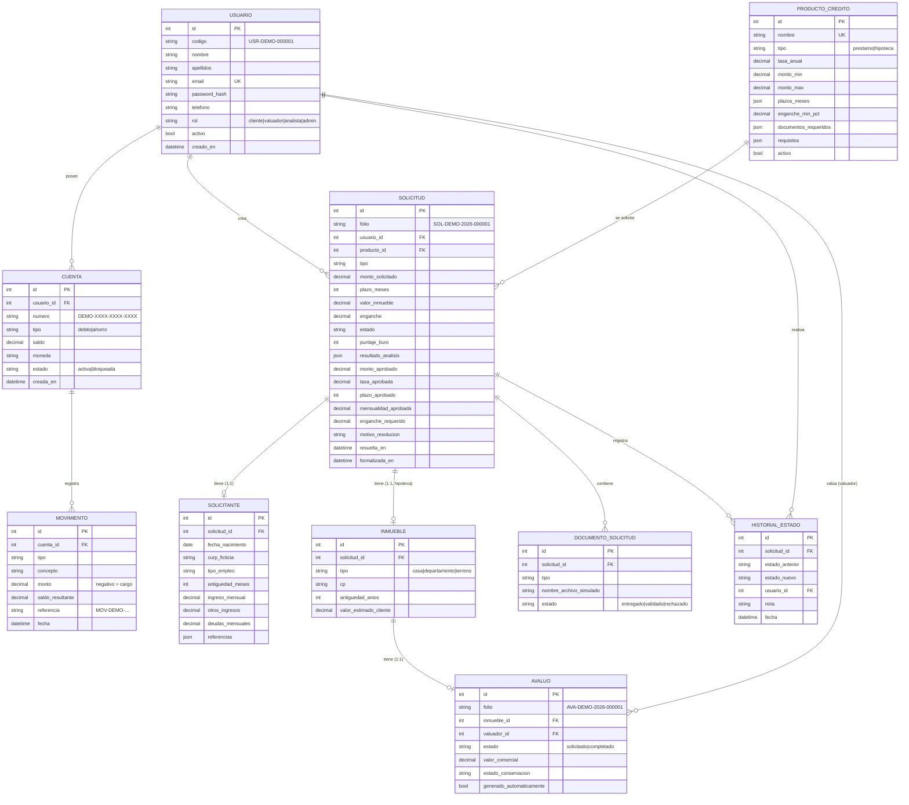
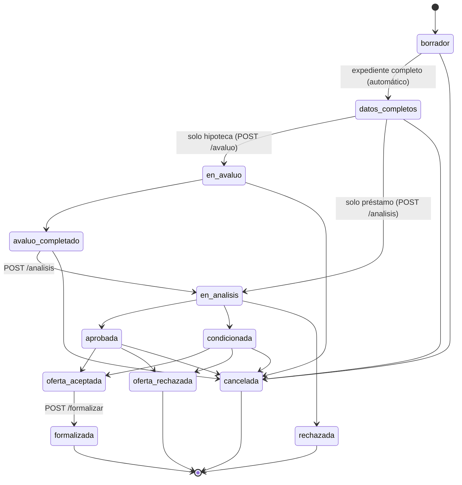

# Arquitectura — API Banco Demo

## 1. Capas

```
Cliente HTTP
   │
   ▼
Middlewares: CORS → Cabeceras de seguridad → Red permitida → SlowAPI (rate limit)
   │
   ▼
routers/        HTTP: rutas, códigos de estado, documentación OpenAPI, sobre de respuesta
   │  depends
   ▼
dependencies/   autenticación JWT (get_usuario_actual), require_roles, paginación
   │
schemas/        Pydantic v2: validación de entrada y forma de salida (camelCase)
   │
   ▼
services/       reglas de negocio; lanzan ApiError; abren y confirman transacciones
   │        └─► utils/  lógica pura: finanzas, análisis, máquina de estados, identificadores
   ▼
models/         SQLAlchemy 2.0 (Mapped / mapped_column)
   │
   ▼
SQLite (banco_demo.db) — o PostgreSQL vía DATABASE_URL
```

Reglas:

- El router **no** contiene lógica de negocio: valida con schemas, llama a un servicio y envuelve el resultado con `ok()` / `paginado()`.
- El servicio **no** conoce HTTP: recibe datos de Python y el usuario actual, y lanza `ApiError(status, code, message, details)`.
- `core/exceptions.py` centraliza el formato de **todos** los errores: `ApiError`, 422 de validación (traducido al español como `{campo, mensaje}`), 404/405 de Starlette, 429 de slowapi y 500 genérico sin traza.

## 2. Decisiones técnicas

| Decisión | Motivo |
|---|---|
| Endpoints síncronos (`def`) | SQLAlchemy síncrono; FastAPI los ejecuta en un pool de hilos. Es más simple y suficiente para un laboratorio. |
| `Decimal` + `Numeric(12,2)` | Evita errores de punto flotante en dinero. Redondeo `ROUND_HALF_UP` centralizado en `utils/finanzas.redondear`. |
| Montos en JSON como número | Pydantic serializa `Decimal` como texto; se usa un serializador a `float` porque los valores ya vienen redondeados a 2 decimales. |
| Tipo `Correo` propio | `email-validator` rechaza el TLD reservado `.test`; se valida con `test_environment=True` para admitir `@demo-banco.test`. |
| Folios a partir del id (`flush` y luego asignar) | Folios legibles y únicos (`SOL-DEMO-2026-000001`) sin tablas de secuencia. |
| Buró ficticio con SHA-256 del folio | Reproducible y sin estado; las pruebas lo fijan con monkeypatch. |
| Avalúo con `random.Random(id_solicitud)` | Valor reproducible para la misma solicitud. |
| Campo extra `resuelta_en` en Solicitud | Base para calcular la vigencia de 15 días de la oferta. |
| Campo extra `enganche_requerido` | Guarda el enganche necesario en ofertas condicionadas de hipoteca. |
| Formalizar un préstamo deposita el monto | Da coherencia a la simulación: aparece un movimiento “Disposición de préstamo” en la cuenta demo del cliente. |
| Rate limit en memoria (slowapi) | Suficiente para una sola instancia; para varias instancias se usaría Redis como `storage_uri`. |
| JWT con `HTTPBearer` | Botón “Authorize” de Swagger con pegar el token. |

## 3. Modelo de datos



## 4. Máquina de estados



- `utils/estados.py` define `TRANSICIONES`, las restricciones por tipo y `validar_transicion()`, que lanza `400 TRANSICION_INVALIDA` con los estados permitidos en `details`.
- `services/comun.cambiar_estado()` es el único punto que cambia el estado y siempre registra un `HistorialEstado`.
- **Excepción controlada:** `PATCH /resolucion` del analista permite moverse entre `aprobada`, `condicionada` y `rechazada` sin pasar por la tabla de transiciones (es una sobrescritura manual), y también deja registro en el historial.
- El expediente solo se edita en `borrador` y `datos_completos`. Si un analista rechaza un documento en `datos_completos`, la solicitud no retrocede, pero el avalúo y el análisis se bloquean (`DOCUMENTOS_RECHAZADOS`) hasta que el cliente lo vuelva a entregar.

## 5. Reglas del análisis de crédito

Implementadas en `utils/analisis.py` como función pura `evaluar(DatosAnalisis) -> ResultadoAnalisis`.
Umbrales en `core/config.py`.

| # | Regla | Valor | Límite | Tipo de falla |
|---|---|---|---|---|
| 1 | `capacidad_pago` | mensualidad / (ingreso + otros − deudas) × 100 | ≤ 35% | corregible |
| 2 | `ltv` (hipoteca) | monto / valor comercial del avalúo × 100 | ≤ 90% | corregible |
| 3 | `buro` | puntaje ficticio 400–850 (SHA-256 del folio) | ≥ 600 | rechazo |
| 4 | `antiguedad_laboral` | meses | ≥ 6 | rechazo* |
| 5 | `edad_fin_plazo` | edad al terminar el plazo | ≤ 70 | rechazo |

Resolución:

1. Si falla alguna regla de rechazo, la solicitud queda **rechazada** y el motivo enumera las fallas.
2. Si se cumplen todas, queda **aprobada** con el monto, la tasa y el plazo solicitados.
3. Si solo fallan capacidad de pago y/o LTV, se calcula el monto máximo que sí cumple:
   `min(solicitado, monto_maximo_por_pago(35% ingreso neto), 90% valor comercial)`, truncado a centenas.
   - Si ese monto es menor que `monto_min` del producto, queda **rechazada**.
   - Si no, queda **condicionada** con ese monto, su mensualidad y, en hipoteca, el enganche requerido (valor del inmueble − monto).
4. Tasa aprobada: la tasa del producto, con 1 punto porcentual menos si el buró es ≥ 750. La capacidad de pago se evalúa con la tasa ya descontada.

\* **Decisión de diseño:** el enunciado indica que la antigüedad menor a 6 meses “se acepta pero el análisis la penaliza”, sin decir cómo. Como la condicionada se reserva para capacidad de pago y LTV, la antigüedad insuficiente lleva a **rechazo**.

`resultado_analisis` guarda `{resolucion, reglas: [{regla, descripcion, valor, limite, cumple}], puntajeBuro, ingresoNeto, pagoMaximo, mensualidadSolicitada, tasaAplicada, fechaAnalisis, montoMaximo?, sobrescritura?}`.

## 6. Cálculos financieros

- **Mensualidad (método francés):** `P = M·i·(1+i)^n / ((1+i)^n − 1)`, con `i = tasa_anual/100/12`. Si la tasa es 0, `P = M/n`.
  *Nota:* 50,000 a 18.5% en 24 meses da **2,508.30** con esta fórmula. El valor aproximado del enunciado (2,520.37) no corresponde a ella, por lo que las pruebas usan el valor exacto, contrastado con un cálculo independiente.
- **Amortización:** el interés de cada mes se redondea a centavos y el último pago absorbe la diferencia, así el saldo final es exactamente 0.00.
- **Monto máximo por pago:** `M = P·(1 − (1+i)^−n)/i`, truncado (ROUND_DOWN) para no exceder el pago máximo.
- **CAT demo:** `((1+i)^12 − 1)·100 + comisión_apertura·12/n` (comisión demo de 1%). Es una aproximación **demostrativa**, no el cálculo oficial de Banxico.

## 7. Seguridad

- JWT HS256 de 60 minutos con `sub` (id) y `rol`. Usuario inactivo: no puede iniciar sesión y sus tokens dejan de valer (403 `USUARIO_INACTIVO`).
- Contraseñas con bcrypt (passlib, `bcrypt==4.0.1`). Nunca se devuelve `password_hash`.
- Contraseña nueva: mínimo 8 caracteres, una mayúscula y un número.
- Rate limit: 5/min en login y 100/min general, por IP.
- CORS restringido a `CORS_ORIGINS`.
- `ALLOWED_NETWORKS`: lista CIDR; fuera de ella → 403 `RED_NO_PERMITIDA`.
- Números de cuenta siempre enmascarados (`****7712`).
- Cabeceras `X-Content-Type-Options`, `X-Frame-Options`, `Referrer-Policy` y `X-Demo: true`.
- `DOCS_ENABLED=false` apaga Swagger, ReDoc y el esquema OpenAPI.
